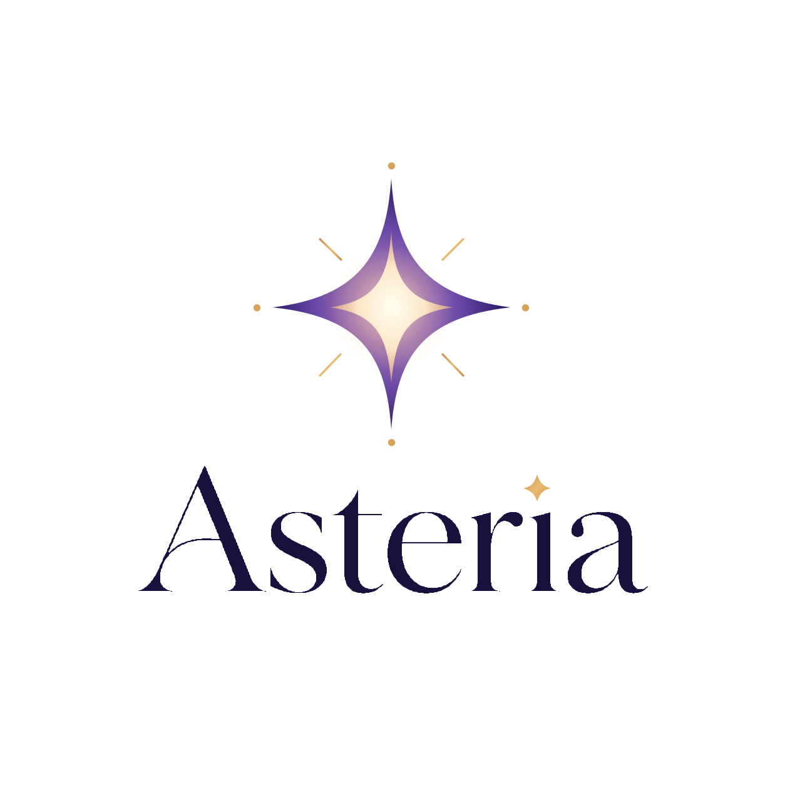
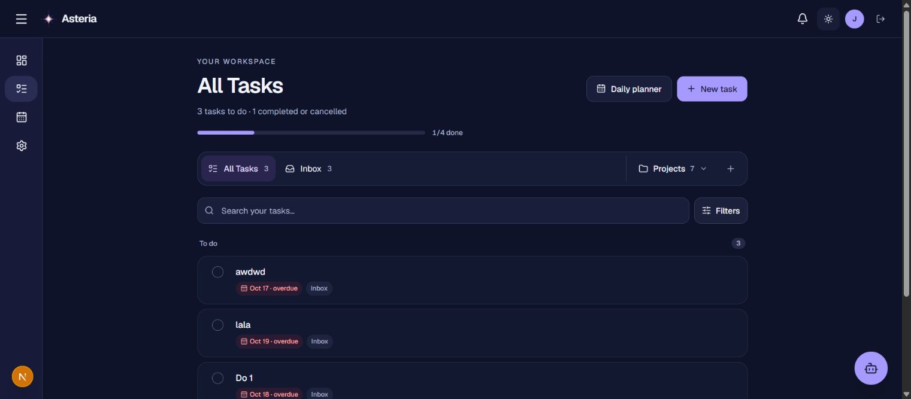

<p align="center">
  
</p>

<h1 align="center">Asteria</h1>
<p align="center"><strong>Your AI-powered Personal Operating System.</strong></p>
<p align="center">Calendar, tasks, daily planning, and notifications in one workspace, with an AI assistant and optional Google Calendar and Discord integrations.</p>

<p align="center">
  <a href="#features">Features</a> ·
  <a href="#quick-start">Quick start</a> ·
  <a href="#architecture">Architecture</a> ·
  <a href="#documentation">Docs</a>
</p>

> **Project status (October 2026):** Asteria is an evolving MVP, not a declared production-ready service. The notification-system report records that database migration `20261026_notification_system` was applied and verified on October 25, 2026. **Live scheduler activation and end-to-end Discord delivery are not yet confirmed.** See [notification rollout notes](docs/notification-system.md). The recorded local test results do not replace deployment verification.

## Features

| Area | Current implementation |
| --- | --- |
| **Dashboard** | Today's schedule, ongoing/next events, tasks, deadlines, and daily plan widgets. |
| **Calendar** | Month/week/day views, recurring events, occurrence overrides/cancellations, task time blocks, and conflict warnings. |
| **Tasks & Projects** | Tasks, subtasks, priorities, deadlines, difficulty, estimates, progress, project grouping, and dependencies. |
| **Daily Planner** | Arrange tasks for a date and generate AI-assisted plans using task and calendar context. |
| **Asteria bot (Hermes)** | Gemini-powered natural-language assistant with validated tools for creating events/tasks, completing tasks, and finding free time. |
| **Google Calendar** | Manual import of selected Google calendars as **read-only mirrors**; push Asteria-owned events to a dedicated Google calendar. See [sync limitations](docs/google-calendar-two-way.md). |
| **Discord** | Optional private-DM bot, one-time account linking, natural-language access to Hermes, and notification delivery. Requires a separate gateway process. |
| **Notifications** | In-app bell, unread count, history, read/dismiss actions, per-user settings, calendar/task/plan triggers, and durable Discord delivery queue. Generation requires an active scheduler. |
| **Theme & layout** | Responsive interface and light/dark themes. |

**On the roadmap, not implemented as full modules:** Study Helper, Fitness Tracker, Finance Tracker, and Notes. Asteria is designed so future modules can contribute context without replacing the productivity core.

<p align="center">
  
</p>

## Tech stack

- **Web:** Next.js 16 App Router, React 19, TypeScript 5, Tailwind CSS 4, Radix UI.
- **Authentication:** Supabase Auth (email/password and Google sign-in).
- **Database:** PostgreSQL / Supabase, Prisma 7 with the PostgreSQL adapter.
- **AI:** Google Gemini API through Hermes tools and the daily-planning flow.
- **Integrations:** Google Calendar API and Discord Gateway / REST API.

## Quick start

Use a compatible Node.js installation (Node.js **22+ recommended** for the separate Discord runner's native `WebSocket`) and npm.

```bash
git clone https://github.com/jomet06/Asteria.git
cd Asteria
npm ci
cp .env.example .env.local
```

Edit `.env.local` with **your own** Supabase and PostgreSQL credentials. See [complete local setup](docs/getting-started.md) for environment variables, Auth redirect configuration, and migration precautions.

```bash
npx prisma validate --config prisma7.config.ts
npx prisma migrate status --config prisma7.config.ts
npx prisma generate --config prisma7.config.ts
npm run dev
```

Visit [http://localhost:3000](http://localhost:3000). **A matching database schema is required** for all features. Before deploying migrations, confirm `DIRECT_URL` points to an intended development/staging database and make a backup; do not run migrations against shared/production data without approval.

Google Calendar, Gemini, and Discord each require separate credentials and setup. The base web app does not start the Discord bot or the notification scheduler for you.

## Optional integrations

- **Google Calendar:** Set Google OAuth and encryption variables, configure the exact `/api/integrations/google/callback` redirect URI, then connect from **Settings**. Supabase Google sign-in and Calendar OAuth are different connections. Read [Google Calendar sync behavior](docs/google-calendar-two-way.md).
- **Hermes / Asteria bot:** Set `GEMINI_API_KEY`; the model and thinking budget are configurable.
- **Discord direct messages:** Set `DISCORD_BOT_TOKEN` and `DISCORD_INTERNAL_SECRET`. In a separate terminal, run `npm run bot -- --dm-only` for DMs **without** running reminder ticks. Generate a 10-minute linking code in **Settings → Discord** and send `link CODE` to the bot.
- **Notification processing:** An authenticated server-side scheduler must POST to `/api/notifications/tick`, typically every minute. This is **not** a browser polling job. Review activation, secrets, worker modes, and delivery caveats in [Notification System](docs/notification-system.md) before enabling live sends.

## Architecture

```text
app/           Next.js routes, server pages, API handlers
components/    Shared UI, navigation, theming
features/      Calendar, tasks, dashboard, Hermes, Discord, notifications
lib/           Authentication and Prisma infrastructure
prisma/        Schema and versioned migrations
scripts/       Offline regression checks and Discord gateway runner
docs/          Setup, design and milestone notes
```

The application backend owns all business rules and owner-scoped database access. Gemini uses validated application tools rather than direct database writes. A scheduler reconciles calendar/tasks/plans into persisted notifications, then dispatches eligible Discord deliveries separately.

Read [architecture and data flows](docs/architecture.md) for details.

## Checks

```bash
npx prisma validate --config prisma7.config.ts
npx tsc --noEmit
npm run lint
npm run build
node --test --test-isolation=none scripts/check-notifications.mjs scripts/check-calendar.mjs scripts/check-event-validation.mjs scripts/check-recurrence-rrule.mjs scripts/check-dashboard.mjs scripts/check-productivity-regression.mjs scripts/check-google-oauth.mjs scripts/check-google-import.mjs scripts/check-google-push.mjs scripts/check-prisma-cache.mjs scripts/check-discord.mjs scripts/check-hermes.mjs scripts/check-task-workspace.mjs
```

The [notification implementation report](docs/notification-system.md) records **237 passing offline tests** and successful validation/build on October 25, 2026. These results are historical, not an automatically running CI badge. The report also records a security warning from Next.js `16.4.0`; update to a security-fixed release and rerun checks before a public rollout.

## Documentation

- [Documentation index](docs/README.md)
- [Getting started & environment](docs/getting-started.md)
- [Architecture & core flows](docs/architecture.md)
- [Notification operations & acceptance](docs/notification-system.md)
- [Google Calendar sync & limitations](docs/google-calendar-two-way.md)
- [Supabase Auth setup](docs/auth-setup.md)
- [Contributing](CONTRIBUTING.md)

## Boundaries and limitations

- Google Calendar import is **manual**, bounded, and read-only inside Asteria; Google-side changes to Asteria-owned recurring instances are not a fully bidirectional sync. The outbound dedicated-calendar push is best-effort.
- Discord bot conversations currently use **private DMs**. Running `npm run dev` alone does not launch the gateway.
- Notifications are persisted, but scheduled collection and outbound sends require an active trusted worker. Discord API delivery is **at-least-once/best-effort with retries**, not guaranteed exactly-once.
- Hermes has bounded conversational context and a limited tool set; do not interpret the assistant marketing copy as a persistent AI memory system.
- Current application timezone support is Asia/Jakarta, Asia/Makassar, Asia/Jayapura, and UTC.

Asteria is under active development. Open the linked implementation docs for exact boundaries rather than assuming every roadmap feature is already available.

