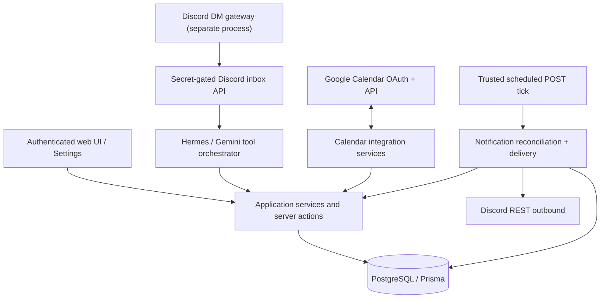

# Architecture and data flows

Asteria is a **modular Next.js application** with a single owner-scoped PostgreSQL backend. Feature modules share authentication and persistence while exposing validated operations to the web UI, Hermes, integrations, and the scheduler.

## Layers

Key source directories:

| Directory | Responsibility |
| --- | --- |
| `app/` | Routes, layouts, Server Components, auth and API entry points. |
| `features/tasks/` | Task, project, subtask, dependency, and Daily Planner logic. |
| `features/calendar/` | Internal events, recurrence, conflict validation and Google integration. |
| `features/hermes/` | Assistant prompts, Gemini requests, context, tools, AI planning. |
| `features/discord/` | DM account linking, bridge configuration, REST responses. |
| `features/notifications/` | Notification policy, persistence, preferences, scheduler and inbox UI. |
| `features/dashboard/` | Today's aggregated workspace data. |
| `lib/` | Supabase Auth, Prisma adapter and common infrastructure. |
| `prisma/` | Data models and additive migration history. |
| `scripts/` | Offline test runners, schema checks and the separate Discord gateway. |

## Core entities and ownership

`Profile` corresponds to the authenticated Supabase user and is the parent for the owner's `Project`, `Task`, `CalendarEvent`, Google Calendar connection/sources/mirrors, Discord connection, and notification state. Tasks can have subtasks, a dependency, time blocks, and dated `DailyPlanItem` positions.

Notification storage uses:

- `NotificationLog` — canonical inbox/deduplication record; the legacy delivery markers are preserved.
- `NotificationPreference` — per-owner channels, category controls, timing and task/planner traversal cursors.
- `NotificationDelivery` — per-channel durable attempts, status, claim and retry metadata; composite owner FK prevents cross-owner linkage.
- `NotificationSchedulerState` — lease and fair traversal cursors for the trusted scheduler.

**Ownership** is derived from authenticated server sessions or a verified Discord account mapping. Resource reads/mutations are scoped by owner. Business tables restrict browser Supabase roles; application Prisma access is privileged and must remain server-side.

## Main workflows

### Calendar

Local events and task time blocks are persisted in `CalendarEvent`. Recurring series are expanded for display and reminders; occurrence overrides/cancellations are stored as exception rows.

Google Calendar is a deliberately **asymmetric** integration:
- **Google → Asteria:** user-initiated, bounded snapshot import into read-only `GoogleEventMirror` rows.
- **Asteria → Google:** best-effort push of Asteria local events into an owned secondary Google calendar, with retry in Settings.

This does **not** mean arbitrary edits in Google are reconciled back into local Asteria events. Read [the exact limitations](google-calendar-two-way.md).

### Tasks and planning

Task metadata includes priority, deadline, difficulty, estimated duration, progress, status, optional project and a task dependency. `DailyPlanItem` stores the task order by planned date. Hermes AI planning uses tasks and calendar context to propose an ordered daily plan; backend validation controls which task IDs can be saved.

### Hermes / Asteria bot

The Hermes agent collects a **bounded snapshot** of events/tasks, sends a request to Gemini, and executes supported function calls through application tools. Current tools include create event, create task, complete task and find free slots. Do not assume unlimited conversation context or durable AI memory.

The web assistant and the Discord DM inbox share the server-side Hermes logic. The Discord runner handles transport, not business-rule enforcement.

### Notifications and delivery

1. An authenticated scheduler acquires an exclusive, expiring lease.
2. Owner-scoped Calendar, Task and Planner data is reconciled into idempotent `NotificationLog` rows according to saved preferences.
3. In-app clients read persisted inbox state; reads never synthesize reminders.
4. Eligible Discord deliveries are queued, fairly claimed with a lease/fencing token, and sent via Discord REST outside the database transaction.
5. Success, bounded retry, terminal failure and stale-lease recovery are persisted.

The scheduler is **not part of browser polling**. Discord cannot guarantee exactly-once delivery after an ambiguous network response. See [notification operations](notification-system.md) for limits and activation.

## Security principles

- Supabase Auth session is authoritative for web actions; APIs do not trust user-supplied owner IDs.
- Google refresh tokens are encrypted at rest with AES-256-GCM using a server-only key.
- Discord gateway/tick and the dedicated notification scheduler have separate server-only secrets.
- Use least-privilege application and migration credentials; never expose PostgreSQL URLs or integration secrets in a `NEXT_PUBLIC_*` value.
- Enforce permissions in backend services; Gemini is an untrusted decision-maker, **not** a database principal.
- Do not bypass server-owned business validation when adding future modules/tools.

## Operational boundaries

- Supported profile timezones: Asia/Jakarta, Asia/Makassar, Asia/Jayapura and UTC.
- Google snapshot import is bounded and manual; Google push/reconciliation remains best effort.
- Discord gateway is a separate long-running process and currently accepts private DMs.
- Notification processing requires a trusted minute-level trigger. The [October 25 notification report](notification-system.md) records applied schema verification, **not** confirmed live delivery activation.
- Existing offline test results and successful builds should not be presented as proof of production readiness.
- Next.js `16.4.0` emitted a known security warning in the recorded build; security maintenance remains a separate task.

## Adding a new module

Keep feature code under `features/<module>/`, define data/access boundaries and server-side validation, and only then expose UI, Hermes tools or notification triggers. Use additive Prisma migrations with explicit review of RLS, privileges, ownership FKs and safe rollout. Add regression tests under `scripts/` and update the docs index.

See [CONTRIBUTING](../CONTRIBUTING.md) and [development setup](getting-started.md).

